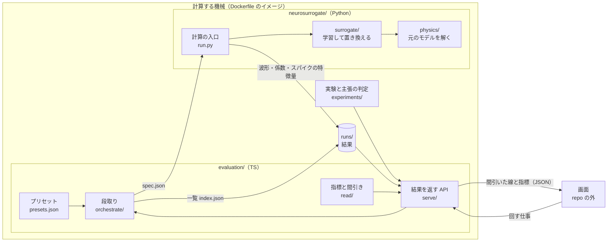
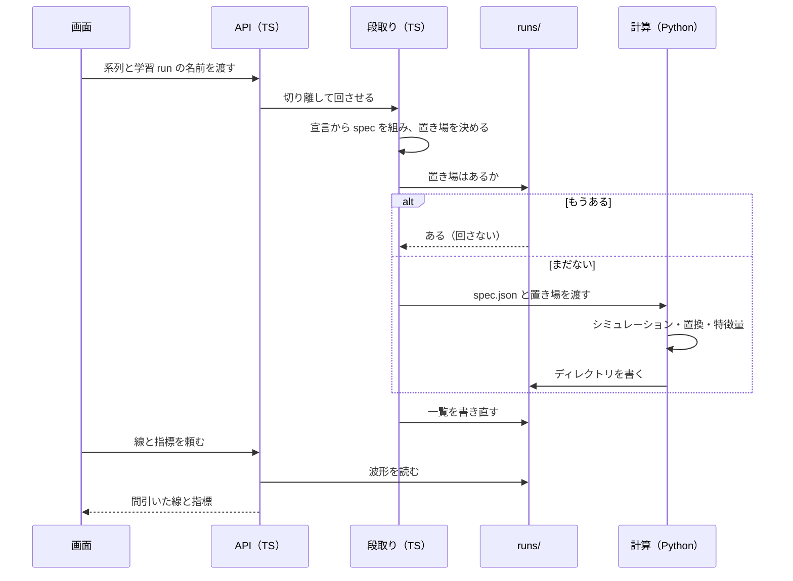
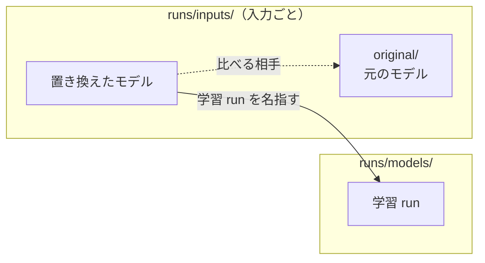

# SINDyNeuroSurrogate

神経細胞モデル（Traub、Hodgkin–Huxley）のゲート変数をまとめて減らし、状態の少ない代理モデル（サロゲート）に置き換える研究コード。まとめ方は二通りで、式から導く KAM 縮約と、データから学ぶ「圧縮 + [SINDy](https://arxiv.org/abs/1904.02107)」を同じ段取りで比べる。

脳の大規模シミュレーションでは、細胞を数千並べると計算より先にメモリの帯域で詰まる。区画あたりの状態を減らせば、そのぶんメモリが減る。

## 全体の地図

計算と結果は、NVIDIA の GPU を持つ計算する機械の上に置く。手元の画面へ渡すのは小さい JSON だけで、波形は回線に出さない。置き場の間を渡るのはデータだけで、TS は Python を import せず、Python は TS を知らない。



- **宣言**：何を回すか（縮約の仕方、群分け、入力の系列）を書く。
- **段取り**：宣言から条件（spec.json）を組み、まだ無い run だけを Python に回させる。学習は GPU（AE の学習だけが GPU を使う）、評価は CPU で回し、どちらで回したかは spec に入る。
- **計算**：元のモデルを解き、サロゲートを学習し、置き換えて回す。回した環境（機械、版、コードとイメージ）を run に書く。
- **API**：runs の隣で、表示の範囲に間引いた線・軌跡・分布・元のモデルとの指標を JSON にして返し、画面から仕事を受けて段取りに回させる。帯域の細い回線でも回る量に保つ。
- **結果**：図はこの repo では描かない。結果はデータとして runs/ に残し、読んで描く側は repo の外に置く。

## 一回の実験の流れ

条件が同じ run はもうあるので、回し直さない。



## 結果の置き場

保存の単位は「学習したモデル」と「入力」の二つ。置き換えたモデルの結果は、使った学習 run を名指し、同じ入力で回した元のモデルと比べる。



## Python と TS の境界

| 渡るもの | 書く側 | 読む側 |
| --- | --- | --- |
| 実験の条件（spec.json） | TS（段取り） | Python |
| 実験の結果（runs/） | Python | TS（API） |
| 間引いた線と指標と主張の判定（API の JSON。口の形は `evaluation/serve/api.ts`） | TS（API） | 画面 |
| ゲートのレートの式（physics/ の JSON） | 人 | Python と TS |

形式の細部と設計の判断基準は [DESIGN.md](DESIGN.md)、ファイルごとの役割は [neurosurrogate/FILES.md](neurosurrogate/FILES.md) にある。

## セットアップ

[uv](https://docs.astral.sh/uv/) と [bun](https://bun.sh/) を使う。手元ではテストと短い確かめだけを回す。

```bash
uv sync
bun install
```

計算する機械（ssh で入れる NVIDIA の GPU の機械）では、[remote.sh](remote.sh) がコードを送り、[Dockerfile](Dockerfile) のイメージ（ベースと道具は digest、Python の依存は `uv.lock` で固定）を向こうで作り、API（:8787）と段取りを回す。

```bash
SINDY_HOST=<host> ./remote.sh up
```
