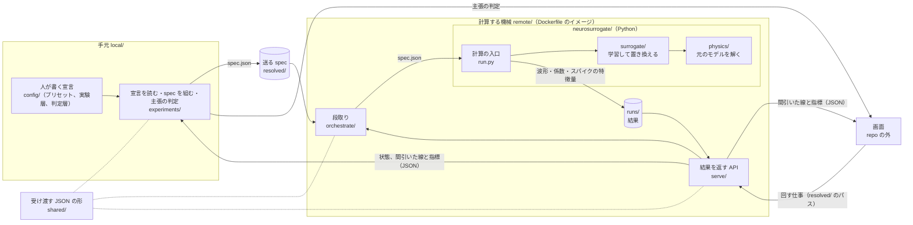
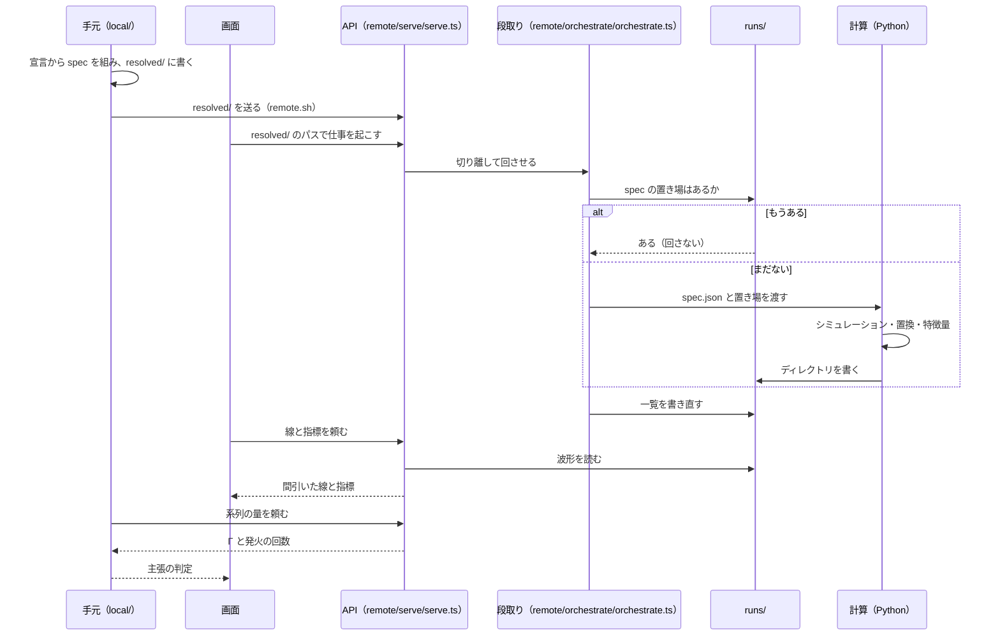
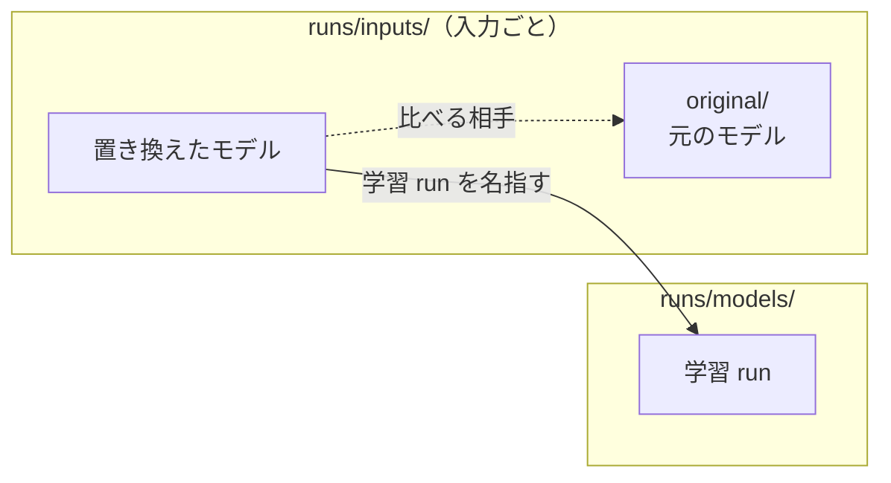

# SINDyNeuroSurrogate

神経細胞モデル（Traub、Hodgkin–Huxley）のゲート変数をまとめて減らし、状態の少ない代理モデル（サロゲート）に置き換える研究コード。まとめ方は二通りで、式から導く KAM 縮約と、データから学ぶ「圧縮 + [SINDy](https://arxiv.org/abs/1904.02107)」を同じ段取りで比べる。

脳の大規模シミュレーションでは、細胞を数千並べると計算より先にメモリの帯域で詰まる。区画あたりの状態を減らせば、そのぶんメモリが減る。

詳しい設計と規則は [AGENTS.md](AGENTS.md)、ファイルごとの役割は [remote/neurosurrogate/AGENTS.md](remote/neurosurrogate/AGENTS.md) にある。

## 全体の地図

手元と計算する機械は JSON だけを受け渡す。行きは `resolved/` の spec、帰りは API の小さい JSON。両方が使うコードは `shared/` だけ。最上位も `local/`（手元）・`remote/`（計算する機械）・`shared/`・`resolved/` に分かれていて、計算する機械へ送るのは `remote/`・`shared/`・`resolved/` だけ。

## 一回の実験の流れ

## 結果の置き場

