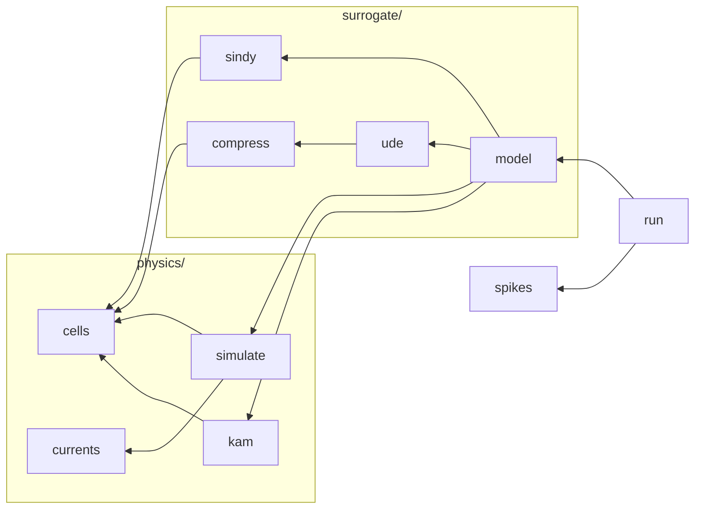

# neurosurrogate のファイル

生成物。手で書き換えない。各ファイルの持つものは、そのファイルの先頭の docstring が正本で、`uv run python tests/test_design.py` がここに集める。

## 依存

矢印は「import する」向き。実際の import から推移的な辺を除いたもの。



## physics/cells.py

区画の式。状態の名前ごとに微分の式を持ち、kernel・初期値・演算コストはそこから組む。

```text
レートの式は隣の hh.json と traub.json が持つ (TS の evaluation/traub/traub.ts も読む)。
Traub の per-comp 定数は traub.c と代数的に等価。
区画は HH・Traub・passive と、Traub19 の区画の定数とネット (NETS)。kernel は
physical_cell が組む。
```

## physics/currents.py

注入電流の名前 → 波形 (SimSpec.current_type が引く選択肢)。

## physics/kam.py

Kepler–Abbott–Marder の縮約。群のゲートを 1 本の等価電位 ψ にまとめる。

```text
学習せず、元の区画の式から組む。群のゲートは定常値 x̄_i(ψ) で作り直し、ψ は
dψ/dt = Σ_i D_i ẋ_i / Σ_j D_j x̄_j'(ψ)、D_i = ∂(dV/dt)/∂x_i で動かす (Kepler 1992 の
式(6)の重みで ẋ_i を等価電位の速さへ写したもの)。φ 群 (膜電位への吸収) は扱わない。
サロゲートの群の圧縮器と右辺 (kam) として使い、学習した圧縮と同じ段取りで比べる。
導き方は context-router の冊 52.01、対話的に動かす版は evaluation/traub/traub.ts。
```

## physics/simulate.py

ネットを解くシミュレータと、波形 (xarray) の形と、実験の記述 (SimSpec・EvalSeries)。

```text
シミュレータは前進 Euler (JAX) の simulate。

波形の Dataset は vars (time × features) と I_ext、I_internal を持つ。features は
(comp_id, variable, gate) の MultiIndex で、gate=False が電位。並びは全区画の電位の
あとに、区画ごとの状態が続く。
```

## surrogate/compress.py

群のゲート ↔ 潜在の圧縮器 (PCA と AutoEncoder)。

```text
どちらも encode・decode・指標・中身・decode の演算コストを持つ。fit の末尾で、学習
データの先頭の潜在 (置換シミュの初期値 gate_inits) と再構成の統計を埋める。
```

## surrogate/sindy.py

SINDy の右辺: 項ライブラリの疎な線形結合を疎回帰で同定する。

```text
項は sympy の式で書き、役割の記号 V (電位)・g (潜在)・u (流入電流) を、同定器へ渡す
列へ束縛する。項の並びは pysindy の feature の並びと一致させ、fit のときに照合する。
```

## surrogate/ude.py

UDE の右辺: 潜在の時間発展を MLP にし、encoder・decoder と同じロスで学習する。

```text
二段 (圧縮器を再構成誤差で固定 → SINDy) だと、圧縮できる座標と式が書ける座標が
一致しない。窓の頭を encode して積分し decode した軌道を、元のゲート軌道に合わせる
ロスで、座標と右辺を一緒に決める。
```

## surrogate/model.py

サロゲート: 区画の状態のどの群を、何で圧縮し、何で時間発展させるか。

```text
設定 (Config) は群のリストで、群ごとに圧縮器と右辺を持つ。群に入らなかった状態は
元のモデルの式のまま解く (hybrid)。form="sindy" は膜電位も含めて丸ごと同定する。
kernel・初期値・演算コストは、群と区画の式から組む。学習 (fit)、置換に使う区画の型
(surrogate_cell)、置換の可否と置換、中身の書き出しもここが持つ。
```

## spikes.py

1 本の波形のスパイクの特徴量 (eFEL)。元のモデルとの比較は図 (evaluation/) が持つ。

## run.py

計算の入口: `uv run python -m neurosurrogate.run <spec.json> <run のディレクトリ>`。

```text
spec.json 1 つを受け取り、run のディレクトリを埋めるだけの純粋な計算。何を回すか、
掃引、ハッシュ、重複の回避、run の置き場と一覧は bun の段取り
(`evaluation/orchestrate/orchestrate.ts`) が持ち、spec の形は同じ
場所の `spec.ts` が持つ。ドメインのどの層からも import されない最上位の層。
spec の種類は 2 つ (`kind`):

- `train` 学習。`surrogate` は設定 (surrogate.Config: 区画の型、形、学習データ、群)。
          置き場は `runs/models/<ハッシュ>/`
- `sim`   入力 × モデルのシミュレーション。`input` は `EvalSeries.to_dict`
          から置換範囲を除いたもの (電流と掃引)。`model` は
          `{train, replace_targets}` か null (元のモデル)。置き場は
          `runs/inputs/<入力のハッシュ>/` の下で、元のモデルは `original/`、
          置き換えたモデルは段取りが組んだ鍵の名前。`train` は
          `runs/models/` の学習 run を指す

書くもの (図が読む形。`.f64` は little-endian の float64 を並べただけ、
JSON の nan は null):

    spec.json  meta.json (kind = train / original / replaced, name, created, 掃引の単位)
    train      surrogate/ (config.json + parts.joblib)、summary.json (学習側の指標)、
               description/model.json、description/train/ (waves と同じ形、点は 1 つ)、
               description/fit/<comp_id>/{x,latent,recon_rmse}.f64
    sim        waves/、spikes.json (comp 名 → 点ごとの spike_features)。置き換えた
               モデルは加えて、projected/<comp>/ (置換した comp の original/ の
               ゲートを潜在へ射影したもの。waves と同じ形)。元のモデルとの比較は
               図が波形と spikes.json から計算する

    waves/meta.json           t0, dt, 点ごとの長さ n, features [[comp_id, 変数, gate]],
                              I_internal の nodes, comp 名 → id
    waves/<点>/comp<id>.f64   その comp の変数 (features の並び順)。変数ごとに連続
    waves/<点>/I_ext.f64      waves/<点>/I_internal.f64 (node ごとに連続)

途中で落ちても半端な run を残さないよう、隣の一時ディレクトリ (`<名前>.partial`)
に書いてから名前を変える。一時ディレクトリには書いているプロセスの pid を置き、図は
それで「計算中」を出す。ディレクトリが既にあれば回さない。置換できない組み合わせは何も書かずに
終了コード 3、同じ run を生きた別のプロセスが書いていれば終了コード 4。
```
