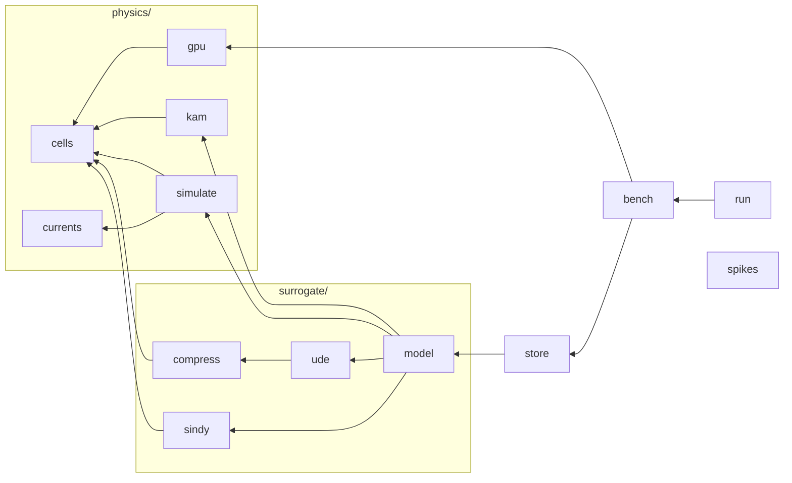

# neurosurrogate のファイル

生成物。手で書き換えない。各ファイルの持つものは、そのファイルの先頭の docstring が正本で、`uv run python tests/test_design.py` がここに集める。

## 依存

矢印は「import する」向き。実際の import から推移的な辺を除いたもの。



## physics/cells.py

区画の式。状態の名前ごとに微分の式を持ち、kernel・初期値・演算コストはそこから組む。

```text
レートの式と単一区画のパラメータは隣の hh.json と traub.json が持つ。
Traub19 の区画ごとの密度・φ・寸法は原著 (Traub et al. 1991) の表 3 と p.637 どおり。
区画は HH・Traub・passive と、Traub19 の区画の定数とネット (NETS)。kernel は
physical_cell が組む。
```

## physics/currents.py

注入電流の名前 → 波形 (SimSpec.current_type が引く選択肢)。

## physics/gpu.py

細胞を並べて、刻みごとに全細胞をそろえて GPU で解く (Pallas の Triton)。

```text
1 スレッドが 1 区画を持つ。区画ごとに値 (密度・寸法・型) が違うので、区画ごとに
カーネルを分け、1 刻みでは区画の数だけカーネルを起こす (全細胞のその区画を並べて回す)。
全区画がその刻みを終えてから次の刻みへ進む。

刻みをまたいで持ち越す状態 (各区画の V、潜在 z、縮約しなかったゲート) はすべて VRAM
(global memory) に変数ごとの配列 (SoA) で置き、毎刻み読み込んで書き戻す。隣の区画の
V は前の刻みの値を VRAM から読む (前進 Euler。CPU の simulate と同じ)。刻みの中だけで
使う値 (z から作り直すゲート、SINDy の項、レート) はカーネルの中の局所の値 (レジスタ)。
```

## physics/kam.py

Kepler–Abbott–Marder の縮約。群のゲートを 1 本の等価電位 ψ にまとめる。

```text
学習せず、元の区画の式から組む。群のゲートは定常値 x̄_i(ψ) で作り直し、ψ は
dψ/dt = Σ_i D_i ẋ_i / Σ_j D_j x̄_j'(ψ)、D_i = ∂(dV/dt)/∂x_i で動かす (Kepler 1992 の
式(6)の重みで ẋ_i を等価電位の速さへ写したもの)。φ 群 (膜電位への吸収) のゲートは
状態を持たず、V での定常値 x̄_i(V) に置く (重み α₀ = 1。φ 群を速いゲートとみなす)。
サロゲートの群の圧縮器と右辺 (kam) として使い、学習した圧縮と同じ段取りで比べる。
導き方は Kepler, Abbott & Marder 1992 (https://doi.org/10.1007/BF00197717)。
```

## physics/simulate.py

ネットを解くシミュレータと、波形 (xarray) の形と、実験の記述 (SimSpec・EvalSeries)。

```text
シミュレータは前進 Euler (JAX) の simulate。

波形の Dataset は vars (time × features) と I_ext、I_internal を持つ。features は
(comp_id, variable, gate) の MultiIndex で、gate=False が電位。並びは全区画の電位の
あとに、区画ごとの状態が続く。
```

## surrogate/compress.py

群のゲート ↔ 潜在の圧縮器 (PCA と AutoEncoder)。

```text
どちらも encode・decode・指標・中身・decode の演算コストを持つ。fit の末尾で、学習
データの先頭の潜在 (置換シミュの初期値 gate_inits) と再構成の統計を埋める。
```

## surrogate/sindy.py

SINDy の右辺: 項ライブラリの疎な線形結合を疎回帰で同定する。

```text
項は sympy の式で書き、役割の記号 V (電位)・g (潜在)・u (流入電流) を、同定器へ渡す
列へ束縛する。項の並びは pysindy の feature の並びと一致させ、fit のときに照合する。
```

## surrogate/ude.py

UDE の右辺: 潜在の時間発展を MLP にし、encoder・decoder と同じロスで学習する。

```text
二段 (圧縮器を再構成誤差で固定 → SINDy) だと、圧縮できる座標と式が書ける座標が
一致しない。窓の頭を encode して積分し decode した軌道を、元のゲート軌道に合わせる
ロスで、座標と右辺を一緒に決める。
```

## surrogate/model.py

サロゲート: 区画の状態のどの群を、何で圧縮し、何で時間発展させるか。

```text
設定 (Config) は群のリストで、群ごとに圧縮器と右辺を持つ。群に入らなかった状態は
元のモデルの式のまま解く (hybrid)。form="sindy" は膜電位も含めて丸ごと同定する。
kernel・初期値・演算コストは、群と区画の式から組む。学習は群 1 つ (学習器) ごとに
行い (fit_group)、学習器の並びをサロゲートに組む。置換に使う区画の型 (surrogate_cell)、
置換の可否と置換、学習器とサロゲートの中身の書き出しもここが持つ。
```

## spikes.py

波形のスパイクの特徴量 (eFEL)。run には書かず、API が頼まれるたびに呼ぶ。

```text
`python -m neurosurrogate.spikes '[{"dt": 刻み, "n": 長さ}, ...]'` が、標準入力の
little-endian float64 を並びの長さで切った波形ごとに、特徴量を JSON の並びで書く
(nan は null)。run の形式は知らない。波形を読んで渡すのも、元のモデルとの比べも
API (../read/comparison.ts) が持つ。
```

## store.py

run の置き場の学習器とモデル: 学習器を書いて読み、モデルの学習器を組む。

```text
置き場は `runs/data/<ハッシュ>/` (学習データ)、`runs/parts/<ハッシュ>/` (学習器 1 つ)、
`runs/models/<ハッシュ>/` (学習器の並びを組んだモデル)。どれも spec.json を持ち、
学習器の spec は学習データを、モデルの spec は学習器をハッシュで指す。
```

## bench.py

GPU の実測: 細胞を並べ、刻みごとに全細胞をそろえて回し、置き場ごとの量を測る。

```text
`uv run python -m neurosurrogate.bench <spec.json> <runs> <細胞の数>
[--out <dir>] [--once]`。
spec は run.py の `bench` の spec (入力と、元のモデルか学習器を組んだモデル)。1 回の呼び出しで
1 つの細胞の数だけを測り、自分で測ったもの (時間、状態の置き方、発火の回数) を JSON で
標準出力に書く。`--out` を渡せば、使ったツールの出力を加工せずにそのディレクトリへ
ツールごとのファイルで書く (JAX の memory_stats、nvidia-smi の CSV)。ncu の CSV は
ncu をかぶせる側 (`cache`) が同じディレクトリに書く。集計は API (remote/read/bench.ts)
が頼まれるたびにこれらから計算する。細胞の数ごとに別のプロセスで呼ぶのは、XLA の先取りを
切って VRAM を細胞の数ごとに測るためと、Nsight Compute (ncu) をかぶせるため。`--once` は
ncu の下で 1 回だけ回す (時間は測らない)。

1 刻みがカーネル 1 回 (physics.gpu)。刻みをまたいで持ち越す状態 (V、潜在 z、縮約
しなかったゲート) は VRAM に置いて毎刻み読み書きし、刻みの中だけで使う値はレジスタに
置く。ncu では途中の 1 刻みのカーネルを測る (VRAM からの読み込みと書き戻しの量、
レジスタの数と溢れ (local memory))。持ち越す状態の数から出した量の予想は自分で書く。
細胞 i には系列の点 i mod 点の数 の電流を入れる。発火の回数は、同じ電流の細胞どうしで
揃うかの確かめに使う。
```

## run.py

計算の入口: `uv run python -m neurosurrogate.run <spec.json> <run のディレクトリ>`。

```text
spec.json 1 つを受け取り、run のディレクトリを埋めるだけの純粋な計算。何を回すか、
掃引、ハッシュ、重複の回避、run の置き場と一覧は bun の段取り
(`../run/`) が持ち、spec の形は
`../../shared/spec.ts` が持つ。ドメインのどの層からも import されない最上位の層。
spec の種類は 5 つ (`kind`)。学習データ → 学習器 → モデル → シミュレーションの順に、
後ろの spec が前の run をハッシュで指す:

- `data`  学習データ。`data` (SimSpec) を元のモデルで回す。
          置き場は `runs/data/<ハッシュ>/`
- `part`  学習器 1 つ (群 1 つの圧縮器と右辺)。`data` は学習データのハッシュで、
          `cell`・`form`・`train_comp`・`group` で学習する。
          置き場は `runs/parts/<ハッシュ>/`
- `model` 学習器の並びを組んだモデル。`parts` は学習器のハッシュの並び (群の順)、
          `cell`・`form`・`absorbed`。学習はせず、組んだ演算コストを書く。
          置き場は `runs/models/<ハッシュ>/`
- `sim`   入力 × モデルのシミュレーション。`input` は `EvalSeries.to_dict`
          から置換範囲を除いたもの (電流と掃引)。`model` は
          `{surrogate, replace_targets}` か null (元のモデル)。置き場は
          `runs/inputs/<入力のハッシュ>/` の下で、元のモデルは `original/`、
          置き換えたモデルは段取りが組んだ鍵の名前。`surrogate` は
          `runs/models/` のモデルを指す
- `bench` GPU の実測。`input` と `model` は sim と同じで、細胞を `cells` の数ずつ
          並べて刻みごとに全細胞をそろえて GPU で回し、細胞の数ごとの `<細胞の数>/` に
          使ったツールの出力を加工せずにツールごとのファイルで書く
          (neurosurrogate.bench)。
          置き場は `runs/bench/<ハッシュ>/`

どれも `device` (cpu か gpu) を持つ。計算の順序が変わって結果がずれるので同一性に
入れ、JAX の backend が合わなければ回さない (backend は呼ぶ側が JAX_PLATFORMS で選ぶ)。
gpu でも GPU を使うのは AE の学習だけで、シミュレーションは CPU で回す。

書くもの (図が読む形。`.f64` は little-endian の float64 を並べただけ、
JSON の nan は null):

    spec.json  meta.json (kind = data / part / model / original / replaced / bench,
               name, created, elapsed = 計算にかかった秒, 掃引の単位, env = 回した環境:
               backend、device、jax と python の版、host、コードとイメージの版)
    data       waves/ (点は 1 つ)
    part       part.joblib (圧縮器と右辺)、part.json (状態・潜在・学習区画の名前、
               右辺と圧縮器の中身、学習側の指標)、
               fit/<comp_id>/{latent,recon_rmse}.f64
    model      summary.json (組んだ 1 刻みの演算コスト。学習器の指標は part.json)
    sim        waves/。置き換えたモデルは加えて、projected/<comp>/ (置換した comp の
               original/ のゲートを潜在へ射影したもの。waves と同じ形)。run は生データ
               だけを持ち、スパイクの特徴量 (spikes.py) と元のモデルとの差は API が
               頼まれるたびに波形から計算する
    bench      <細胞の数>/ に、bench.json (bench.py が自分で測った時間・状態の置き方・
               発火の回数)、jax.memory_stats.{placed,after}.json、nvidia-smi.{apps,gpu}.csv、
               ncu.csv (`ncu` が真なら)。どれもツールの出力のままで、集計は API が
               頼まれるたびに計算する (remote/read/bench.ts)

    waves/meta.json           t0, dt, 点ごとの長さ n, features [[comp_id, 変数, gate]],
                              I_internal の nodes, comp 名 → id
    waves/<点>/comp<id>.f64   その comp の変数 (features の並び順)。変数ごとに連続
    waves/<点>/I_ext.f64      waves/<点>/I_internal.f64 (node ごとに連続)

途中で落ちても半端な run を残さないよう、隣の一時ディレクトリ (`<名前>.partial`)
に書いてから名前を変える。一時ディレクトリには書いているプロセスの pid を置き、図は
それで「計算中」を出す。ディレクトリが既にあれば回さない。置換できない組み合わせは何も書かずに
終了コード 3、同じ run を生きた別のプロセスが書いていれば終了コード 4。
```
